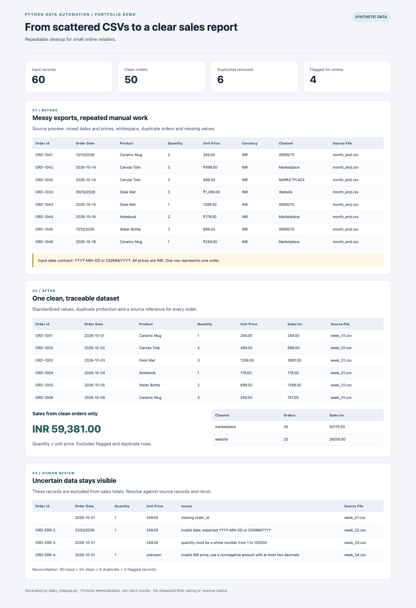
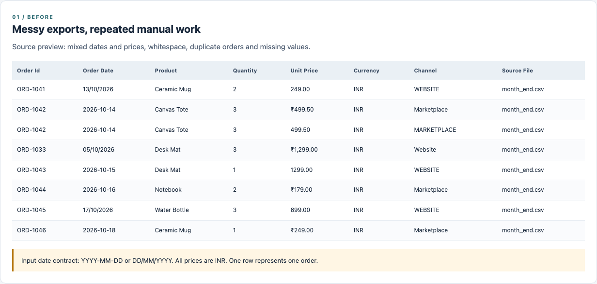
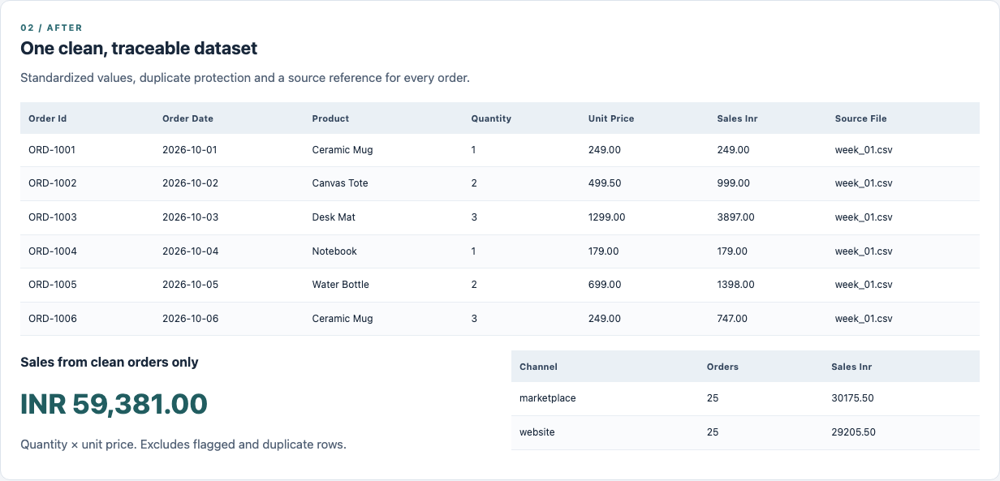

# Sales CSV Cleanup & Consolidation

A Python portfolio demonstration for small online retailers: turn five messy sales exports into a clean order dataset, a sales summary and a clear list of records that need human review.

**All data is synthetic. This is a demonstration, not paid client work.** No real customer, store or transaction information is used. No measured time savings or business impact are claimed.



## The problem

Sales exports often arrive with different column labels, mixed date and price formats, extra whitespace, repeated orders and incomplete records. Combining them manually can count the same sale twice or hide unresolved data problems.

This project demonstrates a repeatable workflow: preserve the source CSVs, standardize known formats, remove duplicate orders, keep uncertain rows visible, and report sales from clean orders only.

## Run it

Requires **Python 3.9 or newer**. The cleanup script uses only the Python standard library; no pip install, credentials or internet connection is needed.

```bash
git clone https://github.com/obey1305/sales-csv-automation.git
cd sales-csv-automation
python3 sales_cleanup.py --input data/raw --output results
```

On Windows, use `py` instead of `python3` if needed. Open `results/report.html` in a browser to view the before-and-after report. Results are already included for browsing without running Python.

To regenerate the fictional inputs:

```bash
python3 generate_demo_data.py
python3 sales_cleanup.py
```

The generator intentionally overwrites the five demo files in `data/raw`; use a separate directory for your own inputs.

## Demonstration results

| Measure | Result |
| --- | ---: |
| Input CSV files | 5 |
| Input records | 60 |
| Clean orders retained | 50 |
| Duplicate records removed | 6 |
| Records flagged for review | 4 |
| Sales from clean orders | INR 59,381.00 |

Every input record is accounted for: **60 = 50 clean + 6 duplicate + 4 flagged**. Sales equal quantity × unit price for clean orders only. This is a sales-value demonstration, not net revenue or profit; taxes, shipping, discounts, refunds and cancellations are outside the schema.

The four flagged demo records contain a missing order ID, an impossible date, a missing quantity and a nonnumeric price. The script does not invent replacements.

### Before: mixed formats and unresolved values



### After: standardized, traceable orders and a sales summary



## Files produced

| Output | Purpose |
| --- | --- |
| `results/cleaned_sales.csv` | Clean orders, calculated sales and source references |
| `results/duplicates.csv` | Excluded identical orders and their source references |
| `results/flagged_rows.csv` | Unresolved raw values, reasons and source references |
| `results/sales_by_channel.csv` | Order counts and sales by sales channel |
| `results/summary.json` | Machine-readable counts, sales total and definitions |
| `results/report.html` | Self-contained, offline before-and-after report |

`source_row` is the 1-based CSV record number, with the header as record 1; quoted multiline fields may span several physical lines. A CSV UTF-8 BOM is included for spreadsheet compatibility. Text starting with `=`, `+`, `-` or `@` is prefixed with an apostrophe in exported CSVs to keep it from being interpreted as a formula. Text already starting with an apostrophe receives a second apostrophe, preserving distinct identifiers. To recover original exported text programmatically, remove exactly one leading apostrophe from escaped fields. Original source files remain unchanged.

## Input contract and cleaning rules

- One row represents **one order with one product**. Multi-line orders must be adapted before use.
- Required columns: `order_id`, `order_date`, `product`, `quantity`, `unit_price`, `currency`, `channel`. Extra or missing columns cause a clear error before results are written.
- Headers are trimmed, lowercased and spaces/hyphens become underscores. Supported aliases: `date`, `qty`, `price`, `sales_channel`.
- Dates accept `YYYY-MM-DD` or **day-first** `DD/MM/YYYY`; `01/10/2026` means 1 October. Other conventions must be mapped explicitly.
- IDs and product names are trimmed but case-sensitive. Channel labels are trimmed and lowercased. No fuzzy matching or product-name guessing occurs.
- Quantity must be a positive integer up to 100,000. Price must be a nonnegative INR amount, at most INR 1,000,000,000, with at most two decimal places. Optional `₹` and correctly grouped thousands commas are supported. Zero-price orders are allowed.
- Currency is normalized to uppercase and must be `INR`. Other currencies are flagged; no exchange-rate conversion is attempted.
- All seven normalized business fields must match for an order to be treated as a duplicate. The first occurrence in sorted filename order is retained. Every excluded duplicate keeps its own source location.
- If an order ID has differing records, **all variants are flagged**, even if one variant is invalid. No arbitrary version wins. Invalid records with no ID are flagged individually.
- Missing required values, invalid quantities, impossible dates and invalid prices are flagged and excluded from totals. Fix source values after review and rerun.
- Blank or structurally malformed CSV records cause an error, rather than silently disappearing. Files must be UTF-8 (with or without BOM). Files are processed in filename order; `.csv` extension is lowercase and discovery is not recursive.

## Use your own data

```bash
python3 sales_cleanup.py --input /path/to/input-csvs --output /path/to/new-results
```

Input and output directories must be separate and not nested within one another. Each successful run overwrites the six named result files in the output directory. Use a new output directory if you need to keep a prior run. File structure and schema errors are checked before output writing; writes are not transactional if a disk or permission failure occurs during export.

This is a small-file demonstration that loads data into memory. The separate commercial service scope can cap file and row counts; this CLI does not enforce that pricing package. It produces CSVs and an HTML report. An `.xlsx` workbook, API integrations, dashboards and scheduled execution would be separate extensions.

## Validation

```bash
python3 -m unittest discover -s tests -v
```

Integration tests exercise the real CLI with temporary files and hand-calculated expected amounts. They cover normalization, duplicate protection, invalid values, conflicting IDs, malformed CSV rows, schema errors, protected source paths, deterministic reruns, HTML escaping and formula-like text in CSV output.

## Client-facing explanation

> I built a Python demonstration that combines five messy sales exports into a clean dataset and sales report. It standardizes known formats, removes repeated orders, and flags records that need clarification. Each output retains a source reference so the retailer can trace the numbers back to the original files.

The approach matches a fixed-scope CSV cleanup service: review sample files, agree on cleaning rules and output definitions, then deliver a reusable script and documented results. This project shows the workflow using fictional data.
